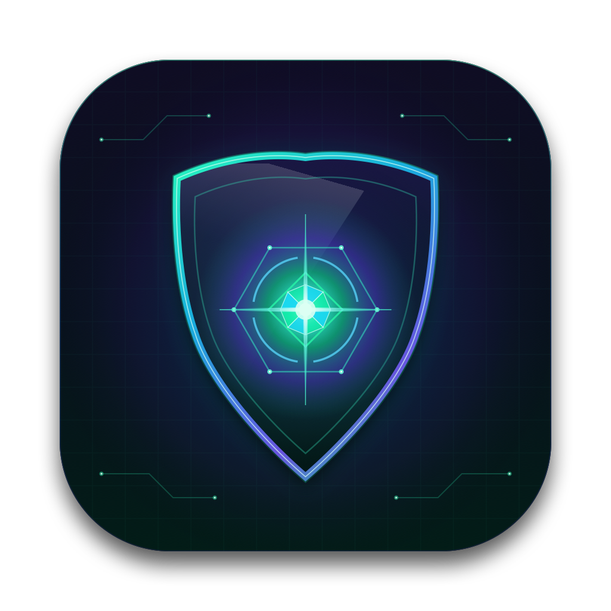
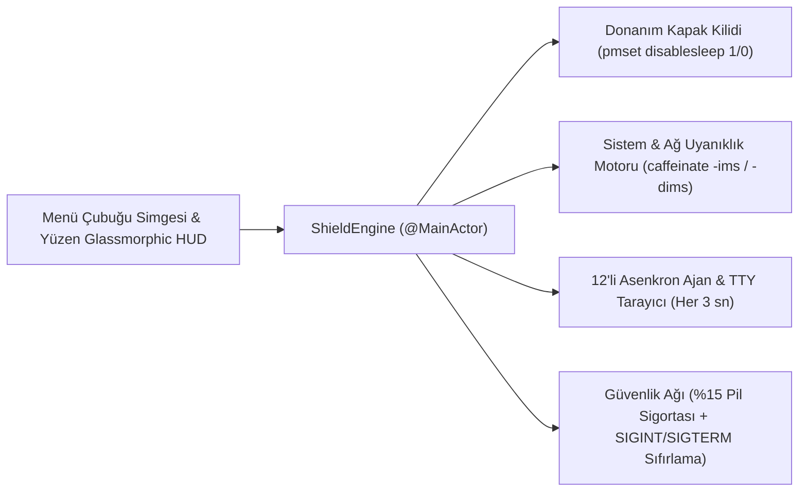

<div align="center">



# 🛡️ Ajan Kalkanı (Agent Shield for macOS)

**MacBook kapağını kapattığınızda otonom kodlama ajanlarınızın ve terminal oturumlarınızın kesintisiz çalışmasını sağlayan, sıfır kaynak tüketimli Native SwiftUI Menü Çubuğu & HUD uygulaması.**

*Keep your autonomous AI coding agents (`Claude Code`, `Codex`, `AGY`, `Cursor`, `OpenCode`, `DeepSeek Harness`) and terminal sessions running at full speed even when your MacBook lid is closed.*

[](https://github.com/kuarezma/ajan-kalkani/releases/latest)
[-0A84FF?style=for-the-badge&logo=apple&logoColor=white)](#)
[](#)
[](LICENSE)

</div>

---

## ✨ Neden Ajan Kalkanı?

Standart `caffeinate` komutları veya klasik ekran açık tutucu uygulamalar, MacBook'un **kapağını kapattığınız anda** (Clamshell Sleep) donanım düzeyindeki derin uykuyu engelleyemez; ağ bağlantısı kopar ve çalışan otonom yapay zeka ajanları yarıda kesilir.

**Ajan Kalkanı**, macOS güç yönetimini (`pmset disablesleep` + `caffeinate`) tek tuşla koordine ederken arka planda çalışan **12 farklı AI kodlama ajanını ve terminal ortamını** gerçek zamanlı izler:

- ⚡ **Tek Dokunuşla Kapak Koruması:** Sağ üst menü çubuğundan veya yüzen Glassmorphic HUD panelinden tek tıkla başlatın, laptop kapağını kapatıp çantanıza veya masaya bırakın.
- 📡 **12'li Canlı Ajan & Terminal Radarı:** Masaüstü IDE uygulamalarını ve CLI/TTY terminal oturumlarını birbirinden ayırarak kaç paralel ajan çalıştığını (`×6`) ve hangi terminal sekmelerinde (`ttys000, ttys001...`) aktif olduğunu canlı gösterir.
- 🧠 **Akıllı Ajan Gözcüsü (Smart Watch):** Ajanlarınız uzun süreli refactor, test veya kod üretim görevini bitirdiğinde MacBook'u otomatik olarak normal uyku moduna döndürür.
- 🤖 **Otomatik Kalkan (Auto-Shield):** Herhangi bir kodlama ajanı başladığında hiçbir tuşa basmanıza gerek kalmadan kalkanı kendiliğinden devreye alır.
- 🔄 **Kesintisiz OTA Otomatik Güncelleme:** GitHub üzerinden yeni sürümleri otomatik denetler, indirir ve aktif kalkan sürenizi tek saniye bile kesintiye uğratmadan günceller.
- 🔒 **Çekirdek Seviyesi Tekil Süreç Kilidi (`flock` & Duvar Saati Motoru):** Darwin çekirdek kilidi (`LOCK_EX | LOCK_NB`) ve `LSMultipleInstancesProhibited` ile mükerrer kopya açılmasını sıfır gecikmeyle engeller; `targetEndDate` duvar saati ve App Nap korumasıyla kapak kapalıyken bile saniye şaşmaz.
- 🔋 **Düşük Pil Güvenlik Sigortası:** MacBook şarjda değilken pil `%15` seviyesinin altına düşerse veri kaybını ve aşırı deşarjı önlemek için uyku kilidini otomatik kaldırır.
- 🪶 **Tüy Kadar Hafif:** Electron veya web sarmalayıcı içermez. %100 **Native Swift 6 & SwiftUI** ile yazılmıştır (`%0.0` boşta CPU kullanımı).

---

## 📡 Tanınan 12 Kodlama Ajanı ve Terminal Ortamı

Ajan Kalkanı her 3 saniyede bir sıfır blokajlı arka plan taramasıyla aşağıdaki tüm ajanları ve terminal kabuklarını canlı olarak tanır:

| # | Ajan / Ortam | Kategori | Algılanan Süreç & İmzalar |
| :--- | :--- | :---: | :--- |
| **1** | **Claude Code** | `APP / IDE` | `Claude.app` masaüstü uygulaması |
| **2** | **Claude Terminal** | `CLI / TTY` | `claude`, `claude remote-control`, `claude-science` CLI oturumları |
| **3** | **Codex** | `APP / IDE` | `Codex.app` ve `codex-code-mode-host` süreçleri |
| **4** | **Codex Terminal** | `CLI / TTY` | `codex`, `codex-cli` terminal oturumları |
| **5** | **AGY** | `APP / IDE` | `Antigravity.app`, `agy-hud-daemon`, `agy-companion` |
| **6** | **AGY Terminal** | `CLI / TTY` | `agy`, `agyc`, `antigravity-cli` terminal oturumları |
| **7** | **Cursor** | `APP / IDE` | `Cursor.app` ana IDE süreci |
| **8** | **Cursor Agent Terminal** | `CLI / TTY` | `cursor-agent`, `agent` CLI oturumları |
| **9** | **OpenCode** | `APP / IDE` | `OpenCode.app` masaüstü uygulaması |
| **10** | **OpenCode Terminal** | `CLI / TTY` | `opencode` CLI terminal oturumları |
| **11** | **DeepSeek Harness** | `APP / IDE` | `DeepSeek Harness.app` ve `dsh` / `deepseek-harness` CLI |
| **12** | **Terminal Havuzu** | `KABUK` | `macOS Terminal`, `iTerm2`, `Warp`, `Ghostty`, `tmux`, `cmux` + aktif `TTY` sayısı |

---

## 🎛️ Çalışma Modları ve Süre Seçenekleri

### ⏱️ Hızlı Süre Seçimi
- **Hazır Süreler:** `15 dk` • `30 dk` • `1 Saat` • `2 Saat` • `4 Saat` • `8 Saat` • `Süresiz (∞)`
- **Canlı Süre Ayarı:** Kalkan aktifken `-15d` ve `+15d` düğmeleriyle geri sayımı anında uzatın veya kısaltın.
- **Sağ Tık Kısayolu:** Menü çubuğundaki `🛡️ Kalkan` simgesine **Sağ Tıklayarak** (veya `Option + Sol Tık` ile) pencereyi açmadan kalkanı anında açıp kapatın.

### 🛡️ 3 Akıllı Koruma Modu
1. **Kapak Kapalı Ajan Modu (`Varsayılan`):**
   - `pmset disablesleep 1` ve `caffeinate -ims` kombinasyonunu çalıştırır.
   - Kapak kapandığında ekran arka ışığı kapanarak ısınmayı ve pil tüketimini önler; ancak **CPU, Disk, Wi-Fi ve tüm Ajan/Terminal süreçleri** %100 performansla çalışmaya devam eder.
2. **Kapak + Ekran Açık Modu:**
   - Hem kapak uykusunu hem de ekranın kararmasını / ekran koruyucuyu (`caffeinate -dims`) tamamen engeller.
3. **Akıllı Ajan Gözcüsü Modu:**
   - Kapak kapalıyken ajanlarınızı korur; izlediğiniz kodlama ajanlarının tamamı görevini bitirdiğinde uykuyu otomatik serbest bırakır.

---

## 🚀 Kurulum (Tek Komut)

Projeyi klonlayıp derlemek ve `/Applications/Ajan Kalkanı.app` olarak kurmak için:

```bash
git clone https://github.com/kuarezma/ajan-kalkani.git
cd ajan-kalkani
chmod +x install.sh
./install.sh
```

### 🔐 Şifresiz Tek Tuş Deneyimi (İsteğe Bağlı `sudoers` Ayarı)
macOS'ta kapak uykusunu (`pmset disablesleep`) her seferinde yönetici şifresi girmeden tek tıkla değiştirebilmek için bir defaya mahsus şu komutu çalıştırabilirsiniz:

```bash
echo "$(whoami) ALL=(root) NOPASSWD: /usr/bin/pmset disablesleep 1, /usr/bin/pmset disablesleep 0" | sudo tee /etc/sudoers.d/ajan-kalkani
sudo chmod 0440 /etc/sudoers.d/ajan-kalkani
```
*(Bu ayar yapılmazsa uygulama kalkanı açarken standart macOS yönetici parolası penceresi gösterir.)*

---

## 🏗️ Mimari Yapı



- **`Sources/AjanKalkaniApp.swift`** — Tüm UI, durum yönetimi, `IOKit` pil telemetrisi, 12'li süreç/TTY radarı ve güç yönetimi motorunu içeren sıfır bağımlılıklı tek dosya mimarisi.
- **`Resources/AppIcon.icns` & `Info.plist`** — Yüksek çözünürlüklü Retina uygulama ikonu ve paket yapılandırması.
- **`install.sh`** — Swift 6 `-O` optimizasyonuyla derleme, `.app` paketleme ve imzalama betiği.

---

## 🛡️ Güvenlik ve Kararlılık Mimarisi
- **Çıkış, Başlangıç ve Çökme Sigortası:** Uygulama normal kapatıldığında (`applicationWillTerminate`), `SIGINT` / `SIGTERM` sinyali aldığında veya önceki bir çökmeden sonra yeniden açıldığında yetim `pmset disablesleep` kilitlerini otomatik sıfırlayarak Mac'in standart uyku davranışıyla tam senkronizasyon sağlar.
- **Sıfır Disk Önbellek Kirliliği:** OTA sürüm kontrolleri `URLSessionConfiguration.ephemeral` ile bellekte yapılır; `~/Library/HTTPStorages` veya `Caches` altında LaunchServices çakışmasına yol açabilecek kalıntı klasörler oluşturmaz.

---

## 📄 Lisans

Bu proje [MIT Lisansı](LICENSE) altında açık kaynak olarak sunulmaktadır.
